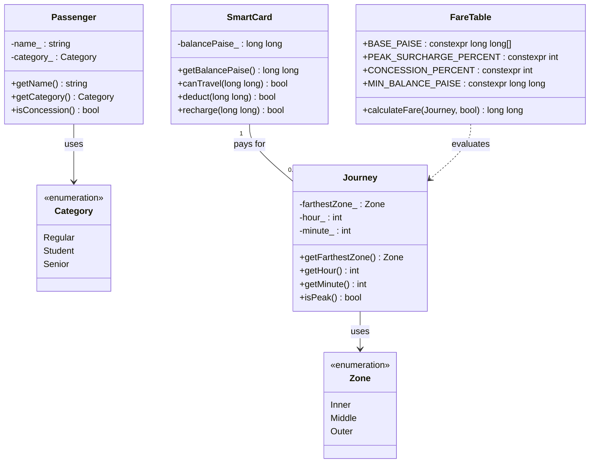

# Task 01: Understand the Problem and Identify the Objects

## Bloom’s Taxonomy Level: K5 (Evaluate) | Total Marks: 4

---

## 1. Problem Analysis & System Context

The Namma Metro smart-card ticketing system automates journey entry/exit validation, dynamic fare deduction, and concession handling. The initial rapid prototype suffered from four severe real-world defects:
1. **Paisa Precision Inaccuracy**: Fares were off by fractional amounts due to floating-point rounding.
2. **Inconsistent Peak Boundaries**: 10:00 AM and 08:00 PM were inconsistently classified as peak or off-peak.
3. **Negative Balance Anomalies**: Cards ended up with negative balances because balance deductions were decoupled from rule enforcement.
4. **Scattered Constants & Magic Numbers**: Fare amounts (Rs 10, 20, 30) were hardcoded in multiple functions across the codebase.

### Root Cause Analysis
Every failure stems from a single design flaw: **the absence of distinct ownership of data and business invariants**. 

In an object-oriented paradigm, every entity is an autonomous object with clear boundaries, private internal state, and strict public interfaces. This design ensures that:
* Monetary values are stored strictly as whole integers (paise in `long long`).
* Card balances can only be modified through guarded member functions that preserve the Rs 50 minimum reserve rule.
* Fare constants and surcharge formulas live in exactly one location.

---

## 2. Object Identification, Attributes, and Responsibilities

The system is decomposed into five core domain entities:

| Object / Entity | Attributes (State) | Methods (Behaviour) | Architectural Justification |
| :--- | :--- | :--- | :--- |
| **`SmartCard`** | • `balancePaise_` (`long long`, private) | • `getBalancePaise()`<br>• `canTravel(fare)`<br>• `deduct(fare)`<br>• `recharge(amount)` | **Owns the money.** The smart card is the financial custodian. Making `balancePaise_` private guarantees that no external gate function can bypass the Rs 50 reserve rule or cause a negative balance. |
| **`Passenger`** | • `name_` (`std::string`)<br>• `category_` (`Category` enum) | • `getName()`<br>• `getCategory()`<br>• `isConcession()` | **Owns passenger identity & eligibility.** Concessions (e.g., 50% for students and senior citizens) are properties of the traveler, not the physical journey or the fare table. |
| **`Journey`** | • `farthestZone_` (`Zone`)<br>• `hour_` (`int`, 0–23)<br>• `minute_` (`int`, 0–59) | • `getFarthestZone()`<br>• `getHour()`<br>• `getMinute()`<br>• `isPeak()` | **Encapsulates one travel event.** A journey represents an atomic passage through the fare gate. It encapsulates the temporal context needed to evaluate whether peak surcharge applies. |
| **`Zone`** | • `Inner`, `Middle`, `Outer` (`enum class`) | • *Value type* | **Defines domain boundaries.** Using an `enum class` instead of raw integers prevents accidental arithmetic mixing, invalid zone indices, and implicit conversions. |
| **`FareTable`** | • `BASE_PAISE[]`<br>• `PEAK_SURCHARGE_PERCENT`<br>• `CONCESSION_PERCENT`<br>• `MIN_BALANCE_PAISE` | • `calculateFare(journey, hasConcession)` | **Single source of truth for pricing.** All fare matrices, surcharges, and discount formulas live here. Revisions are localized to this single class. |

---

## 3. Procedural vs. Object-Oriented Paradigm Comparison

| Architectural Aspect | Purely Procedural Style | Object-Oriented Style |
| :--- | :--- | :--- |
| **State Storage** | Global variables (e.g., `long long balance;`) or exposed structs. | Encapsulated private members (`balancePaise_`) within `SmartCard`. |
| **Invariant Enforcement** | **Caller-dependent**: Every gate function must manually remember to check `balance - fare >= 5000` before subtracting. | **Self-enforcing**: `SmartCard::deduct()` internally verifies `canTravel()` before mutating state. |
| **Failure Mode** | Any rogue or hurried developer can write `balance -= fare;` directly, creating negative balances. | Direct access is rejected by the compiler. Invariant violation is structurally impossible. |
| **Maintainability** | Changing the minimum balance rule requires auditing every file that accesses `balance`. | Changing the rule requires modifying exactly one class: `SmartCard`. |

---

## 4. Mapping the Four Core OOP Principles



### 1. Encapsulation (Implemented in Code)
* `SmartCard` encapsulates `balancePaise_` as a `private` member variable. External functions have no direct write access to this variable.
* All modifications must pass through `canTravel()` and `deduct()`, which enforce the Rs 50 minimum reserve rule before any subtraction occurs.
* `FareTable` encapsulates the fare calculation logic, preventing pricing formulas from scattering across gate control loops.

### 2. Abstraction (Implemented in Code)
* The fare gate interacts with high-level conceptual operations: `FareTable::calculateFare(journey, isConcession)` and `card.deduct(fare)`.
* The caller is completely abstracted from the internal mechanics of half-up percentage integer rounding, bit shifts, minute conversions, and zone index mapping.

### 3. Inheritance (Architectural Evaluation – Potential Extension)
* *Implementation Note*: In this introductory Task 01 model, inheritance is evaluated as a design option rather than implemented as unnecessary subclassing. A simple `Category` enumeration (`Regular`, `Student`, `Senior`) is used.
* *System Mapping*: In an expanded enterprise system, specialised passenger types (e.g., `StudentPassenger`, `SeniorCitizenPassenger`) could inherit shared attributes (`name_`, `card_`) from an abstract base `Passenger` class. In Task 12, monthly pass entitlements similarly extend journey validation.

### 4. Polymorphism (Architectural Evaluation – Potential Extension)
* *Implementation Note*: In Task 01, fare calculation relies on direct parameterization. Dynamic polymorphism via virtual functions is not artificially forced into this preliminary model.
* *System Mapping*: If discount policies expand dynamically (e.g., promotional discounts, weekend waivers, special holiday passes), a base class `DiscountRule` with a pure virtual `apply(long long baseFare)` method could allow polymorphic discount pipelines without modifying the gate controller.

---

## 5. System Invariants & Business Rules

Every valid journey must satisfy the following explicit rules:

* **Rule R1 (Minimum Reserve Balance)**: A journey is permitted if and only if the balance remaining on the smart card *after* fare deduction is at least Rs 50.00 (5,000 paise):
  $$\text{balance} - \text{fare} \ge 5000$$
  This rule ensures a card balance can never drop below Rs 50, preventing negative balances.
* **Rule R2 (Farthest Zone Pricing)**: Base fare is determined solely by the farthest zone travelled:
  * Inner Zone: Rs 10 (1,000 paise)
  * Middle Zone: Rs 20 (2,000 paise)
  * Outer Zone: Rs 30 (3,000 paise)
* **Rule R3 (Peak Hour Windows & Surcharge)**:
  * AM Peak: 08:00 to 09:59 inclusive ($[08:00, 10:00)$).
  * PM Peak: 17:00 to 19:59 inclusive ($[17:00, 20:00)$).
  * Peak surcharge is 20% added to the base fare (or concession-adjusted fare).
* **Rule R4 (Concession Eligibility)**: Students and senior citizens receive a 50% concession on base fare (Assumption A1).
* **Rule R5 (Currency Representation)**: All monetary values are maintained in integer paise (`long long`). No floating-point data types (`float`, `double`) are used for storing or calculating money.
* **Rule R6 (Validation Invariants)**: Recharges must be strictly positive ($> 0$). Invalid zones or times must be rejected at input validation.
* **Rule R7 (Single Source of Truth)**: Every fare constant is declared as a `constexpr` in a centralized header, avoiding scattered magic literals.

---

## 6. Alternative Concept & Complexity Analysis

### Purely Procedural Alternative
In a purely procedural architecture, state is maintained via global variables and operated on by free functions:

```cpp
// Procedural representation
long long g_balance = 10000;
const long long BASE_PAISE[] = {1000, 2000, 3000};
const long long MIN_BAL_PAISE = 5000;

long long computeFare(int zone, int hour, int minute, bool concession) {
    long long f = BASE_PAISE[zone];
    if (concession) f -= (f * 50 + 50) / 100;
    int t = hour * 60 + minute;
    if ((t >= 480 && t < 600) || (t >= 1020 && t < 1200)) {
        f += (f * 20 + 50) / 100;
    }
    return f;
}

void deductFare(long long f) {
    g_balance -= f; // Vulnerability: does not check MIN_BAL_PAISE
}
```

### Complexity & Maintenance Comparison

#### A. Runtime Complexity Analysis
* **Procedural Approach**: $\mathcal{O}(1)$ time per fare computation. Performs 1 array index lookup, at most 2 integer percentage calculations, 1 comparison, and 1 subtraction.
* **Object-Oriented Approach**: $\mathcal{O}(1)$ time per journey. The member functions `isPeak()`, `calculateFare()`, `canTravel()`, and `deduct()` execute a fixed, bounded sequence of arithmetic operations and comparisons. There are no iterative loops or recursions.

#### B. Space Complexity Analysis
* **Procedural Approach**: $\mathcal{O}(1)$ storage per card. The balance is stored in a single primitive `long long` variable (8 bytes on 64-bit platforms).
* **Object-Oriented Approach**: $\mathcal{O}(1)$ storage per card. The `SmartCard` class contains a single private `long long balancePaise_` data member. On a 64-bit architecture, `sizeof(SmartCard)` is exactly 8 bytes (identical to primitive storage, with zero object header overhead because no virtual function table pointer is introduced).

#### C. Maintenance Impact & Blast Radius (Qualitative Comparison)
* **Procedural Approach (High Maintenance Coupling)**:
  * Because state (`g_balance`) is global or passed through loosely typed structures, any function across any compilation unit can modify it directly.
  * If the minimum reserve rule changes (e.g., from Rs 50 to Rs 60), every call site where balance deductions occur must be audited by hand to ensure `canTravel()` is not omitted.
  * Forgetting the guard check at even one call site introduces silent negative balance bugs.
* **Object-Oriented Approach (Encapsulated Localization)**:
  * Invariant enforcement is tightly encapsulated inside `SmartCard::deduct()`.
  * External code has no direct access to `balancePaise_` and must call `deduct()`, which guarantees that the rule is evaluated every time without caller vigilance.
  * When the reserve rule changes, only `FareTable::MIN_BALANCE_PAISE` is modified. The rest of the gate codebase remains untouched.

---

## 7. Evidence of Compilation & Execution

The companion implementation `metro_model_preview.cpp` was compiled with:
```bash
g++ -std=c++17 -Wall -Wextra -pedantic Task01/metro_model_preview.cpp -o Task01/task01.exe
```

### Actual Execution Output
```
========================================================
  Task 01: Namma Metro Smart-Card Object Model Preview  
========================================================

Passenger: Aarav | Concession: Eligible (50%)
Initial Card Balance: Rs 100.00

Trip 1: Outer Zone at 09:00 (Peak AM, Concession Applied)
  Calculated Fare: Rs 18.00
  Gate Decision: ALLOWED | Remaining Balance: Rs 82.00

Trip 2: Outer Zone at 12:00 (Off-Peak, Regular Passenger)
  Calculated Fare: Rs 30.00
  Gate Decision: ALLOWED | Remaining Balance: Rs 52.00

Trip 3: Middle Zone at 14:00 (Off-Peak, Regular Passenger)
  Calculated Fare: Rs 20.00
  Gate Decision: DENIED (Insufficient balance to maintain Rs 50 reserve)
  Balance remains safely protected at: Rs 52.00
```
This execution confirms that:
1. Concession of 50% on Outer zone (Rs 30.00 $\rightarrow$ Rs 15.00) with 20% peak surcharge gives exactly Rs 18.00 (1,800 paise).
2. The card balance is safely decremented to Rs 82.00 and then Rs 52.00.
3. Trip 3 is correctly denied when deducting Rs 20.00 would leave Rs 32.00 ($< \text{Rs } 50.00$), leaving the balance intact at Rs 52.00.

